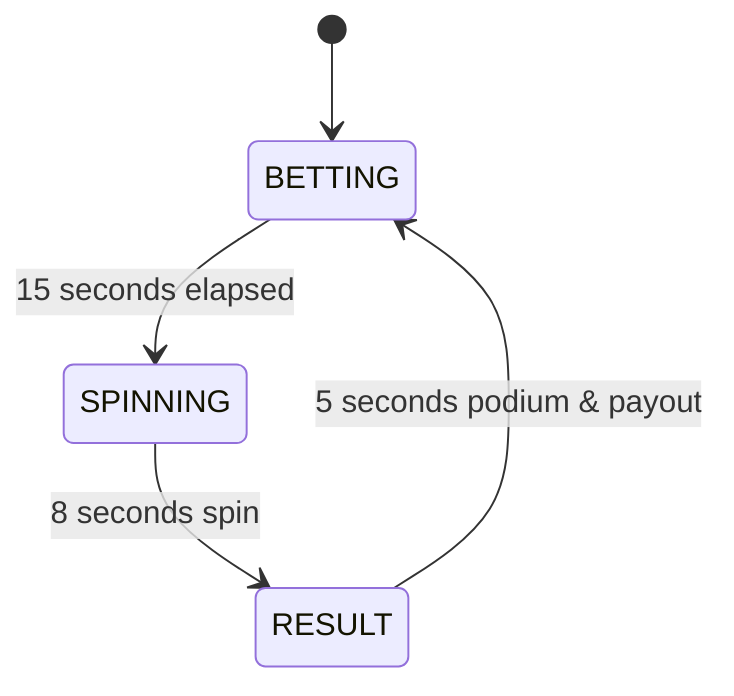

# ⚙️ Greedy Game — Server & Backend API Documentation

The backend of **Greedy** is powered by **Node.js, Express, Socket.IO, and MySQL**. It provides high-concurrency real-time WebSocket communication, state-machine synchronization, fair RNG item selection, and automatic webhook callbacks to your main app backend.

---

## 📁 Backend Directory Layout

```text
backend/
├── database/
│   ├── db.js                 # MySQL2 connection pool & prepared query helpers
│   ├── schema.sql            # Table definitions & automatic migrations
│   └── greedy_game_db.sql    # Complete phpMyAdmin importable SQL dump
├── .env                      # Database credentials, ports, and webhook config
├── package.json              # Node dependencies (express, socket.io, mysql2, cors, dotenv)
└── server.js                 # HTTP server, Socket.io handlers, Game Engine loop
```

---

## 🔄 Game Loop State Machine

The game runs continuously on a 28-second cycle divided into three distinct phases:



### 1. `BETTING` Phase (15 Seconds)
- Players place chips on 8 food pods and 4 combo dishes.
- Server simulates active room activity via guest bets flying from the top-right.
- Ticker broadcasts high-roller bets in real time.
- Final 5 seconds trigger countdown tick audio on clients.

### 2. `SPINNING` Phase (8 Seconds)
- Betting is closed.
- The server selects the winning item using weighted RNG.
- Server broadcasts `spin_start` with target index and duration.
- Client wheel accelerates, smoothly decelerates, and snaps to the winning pod.

### 3. `RESULT` Phase (5 Seconds)
- The server calculates payouts for all real users and guest players.
- Winning pod flashes with golden highlight.
- Winnings are credited to MySQL `users` table and recorded in `game_rounds` and `bets`.
- Webhook callbacks are dispatched to your main app backend (`callbackUrl`).
- Round Podium modal displays the winning dish, payout stats, and top 3 winners.
- Winner is announced on the marquee ticker.

---

## 🎲 Fair-Play Odds & Payout Multipliers

| Food Dish | Index | Type | Weight | Probability | Multiplier |
| :--- | :---: | :--- | :---: | :---: | :---: |
| 🍅 **Tomato** | 4 | Veggie | 19.5 | ~19.5% | **5x** |
| 🌽 **Sweet Corn** | 5 | Veggie | 19.5 | ~19.5% | **5x** |
| 🥬 **Cabbage** | 6 | Veggie | 19.5 | ~19.5% | **5x** |
| 🥕 **Carrot** | 7 | Veggie | 19.5 | ~19.5% | **5x** |
| 🌭 **Hot Dog** | 0 | Meat | 10.0 | ~10.0% | **10x** |
| 🍢 **Kebab Skewer** | 1 | Meat | 6.5 | ~6.5% | **15x** |
| 🍗 **Roast Chicken** | 2 | Meat | 3.8 | ~3.8% | **25x** |
| 🥩 **Beef Steak** | 3 | Meat | 1.7 | ~1.7% | **45x** |

### Lower Base Combo Dishes:
- 🥗 **Vegetable Basket (`veg_combo`)**: Wins **1.25x** on Tomato, Corn, Cabbage, or Carrot.
- 🥗 **Salad Bowl (`salad`)**: Wins **2.0x** on any vegetable.
- 🍕 **Pizza Platter (`pizza`)**: Wins **2.5x** on any meat (Hotdog, Kebab, Chicken, Steak).
- 🥩 **Meat Basket (`meat_combo`)**: Wins **4.37x** on any meat item.

---

## 🐬 MySQL Database Schema

All game data is persistently stored in MySQL. Zero static dummy data is used.

### 1. `users` Table
Stores players, wallet balances, and app integration mapping:
```sql
CREATE TABLE IF NOT EXISTS users (
    id INT AUTO_INCREMENT PRIMARY KEY,
    app_user_id VARCHAR(128) NULL,          -- Your main application's user ID
    username VARCHAR(100) NOT NULL UNIQUE,
    avatar VARCHAR(255) DEFAULT 'avatar1',
    coins BIGINT DEFAULT 10000000,          -- Balance in coins
    diamonds INT DEFAULT 0,                 -- Diamonds
    today_profit BIGINT DEFAULT 0,          -- Daily net profit
    total_profit BIGINT DEFAULT 0,          -- Lifetime profit
    created_at TIMESTAMP DEFAULT CURRENT_TIMESTAMP,
    updated_at TIMESTAMP DEFAULT CURRENT_TIMESTAMP ON UPDATE CURRENT_TIMESTAMP,
    INDEX idx_app_user_id (app_user_id)
);
```

### 2. `game_rounds` Table
Complete historical log of every spin:
```sql
CREATE TABLE IF NOT EXISTS game_rounds (
    id INT AUTO_INCREMENT PRIMARY KEY,
    round_number INT NOT NULL UNIQUE,
    winning_item VARCHAR(50) NOT NULL,
    multiplier DECIMAL(6, 2) NOT NULL,
    total_bets BIGINT DEFAULT 0,
    total_payout BIGINT DEFAULT 0,
    created_at TIMESTAMP DEFAULT CURRENT_TIMESTAMP
);
```

### 3. `bets` Table
Individual record for every chip wagered:
```sql
CREATE TABLE IF NOT EXISTS bets (
    id INT AUTO_INCREMENT PRIMARY KEY,
    round_id INT NOT NULL,
    user_id INT NOT NULL,
    item_id VARCHAR(50) NOT NULL,
    amount BIGINT NOT NULL,
    payout BIGINT DEFAULT 0,
    won BOOLEAN DEFAULT FALSE,
    created_at TIMESTAMP DEFAULT CURRENT_TIMESTAMP,
    FOREIGN KEY (round_id) REFERENCES game_rounds(id) ON DELETE CASCADE,
    FOREIGN KEY (user_id) REFERENCES users(id) ON DELETE CASCADE
);
```

---

## 📡 REST API Reference

All REST endpoints return JSON with standard HTTP status codes.

### 1. Health Check
- **`GET /api/health`**
- **Response:**
  ```json
  { "status": "ok", "serverTime": "2026-10-14T10:25:22.827Z" }
  ```

### 2. Query User Coins & Profile
Used by your main application to query current wallet balance for any player:
- **`GET /api/user/:userId/coins`**
  *(Matches either `app_user_id` e.g. `9002` or database primary key `id`)*
- **Response:**
  ```json
  {
    "success": true,
    "userId": 32,
    "username": "RahulVerma",
    "avatar": "avatar_queen",
    "coins": 12750000,
    "todayProfit": 250000,
    "diamonds": 890
  }
  ```

### 3. User Login / Wallet Sync
- **`GET /api/user/login?userId=9002&username=RahulVerma&avtar=avatar_queen&coins=12500000&diamonds=890`**
- Authenticates or registers the user in MySQL and synchronizes wallet values.

### 4. Today's Revenue Leaderboard
- **`GET /api/leaderboard/revenue`**
- Returns top 20 players ranked by today's net profit.

### 5. Recent Rounds History
- **`GET /api/rounds/recent`**
- Returns the last 15 round outcomes with winning dish and multiplier.

---

## ⚡ Socket.IO Real-Time Event Protocol

### Client to Server Events

| Event | Payload | Description |
| :--- | :--- | :--- |
| `auth_user` | `{ userId, username, avatar, coins, diamonds, callbackUrl }` | Authenticates client and registers session. |
| `place_bet` | `{ itemId: "hotdog", amount: 500 }` | Places bet on a food item or combo dish. |
| `repeat_bet` | *(none)* | Repeats user's previous round bet distribution. |
| `claim_free_coins`| *(none)* | Credits +10,000,000 bonus coins. |
| `get_revenue_ranks`| *(none)* | Requests latest daily leaderboard rankings. |

### Server to Client Events

| Event | Payload | Description |
| :--- | :--- | :--- |
| `init_game_state` | Full game state object | Sent on connect; includes user profile, round, time left, bets. |
| `game_tick` | `{ state, timeLeft, roundNumber, hotItem }` | Emitted every second to keep clocks synchronized. |
| `bet_placed_broadcast` | `{ userId, itemId, chipAmount, podTotal, isGuest }` | Broadcast to all clients when any bet occurs. |
| `spin_start` | `{ roundNumber, winningItem, targetIndex, duration }` | Triggers wheel spin animation on all clients. |
| `round_result` | `{ roundNumber, winningItem, userResults, roundRankings }` | Delivers round settlement, earnings, and podium rankings. |
| `round_start` | `{ roundNumber, timeLeft }` | Clears table and begins new betting phase. |
| `bet_response` | `{ success: true, newBalance, userTotalOnItem }` | Confirmation sent to betting player. |

---

## 🔔 Webhook Notification System (`sendCallbackNotification`)

When a user initializes with a `callbackUrl` in the query parameters:
```text
callbackUrl=https://your-main-app.com/api/coins-webhook
```

The game server sends an HTTP POST request on:
1. **Round Settlement (`ROUND_RESULT`)**: Sent after spin calculation with net profit and updated coins.
2. **Bet Placement (`BET_PLACED`)**: Sent immediately when a user places a wager.

### Webhook HTTP Headers:
```http
POST /api/coins-webhook HTTP/1.1
Host: your-main-app.com
Content-Type: application/json
X-Game-Source: Greedy-Arcade
```

### Webhook JSON Payload:
```json
{
  "event": "ROUND_RESULT",
  "userId": "9002",
  "username": "RahulVerma",
  "previousCoins": 12500000,
  "newCoins": 12750000,
  "delta": 250000,
  "userTotalBet": 50000,
  "userTotalPayout": 300000,
  "diamondsEarned": 71428,
  "roundNumber": 2025,
  "winningItem": "hotdog",
  "multiplier": 10,
  "timestamp": 1773489283000
}
```

---

## 🛠️ Server Management Commands

### Start MySQL
```bash
brew services start mysql
```

### Start phpMyAdmin (Port 8080)
```bash
php -S 0.0.0.0:8080 -t /opt/homebrew/share/phpmyadmin
```

### Start Game Backend Server (Port 3000)
```bash
node backend/server.js
```
*(Or `npm start` inside `backend/` directory)*
